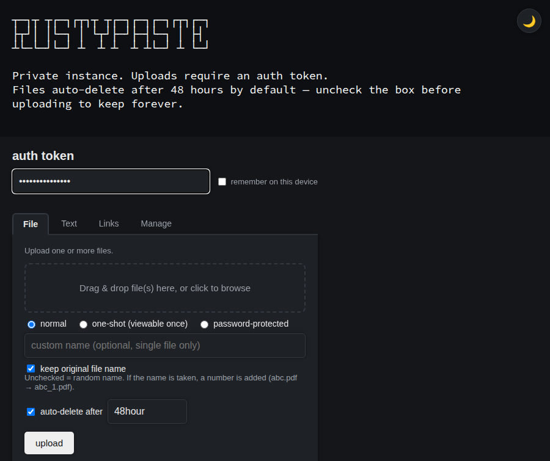
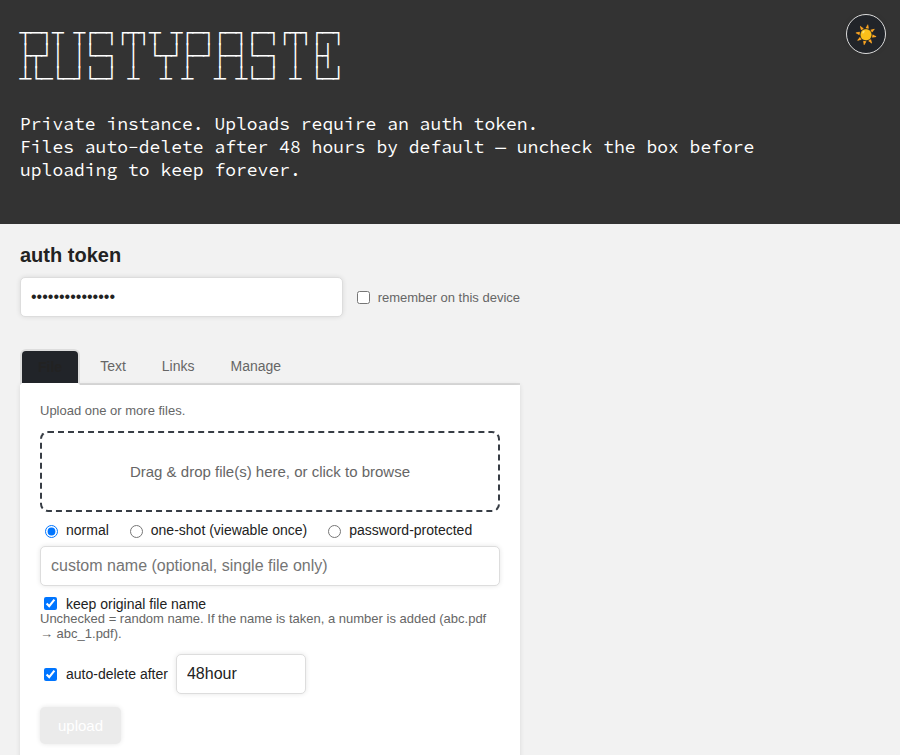
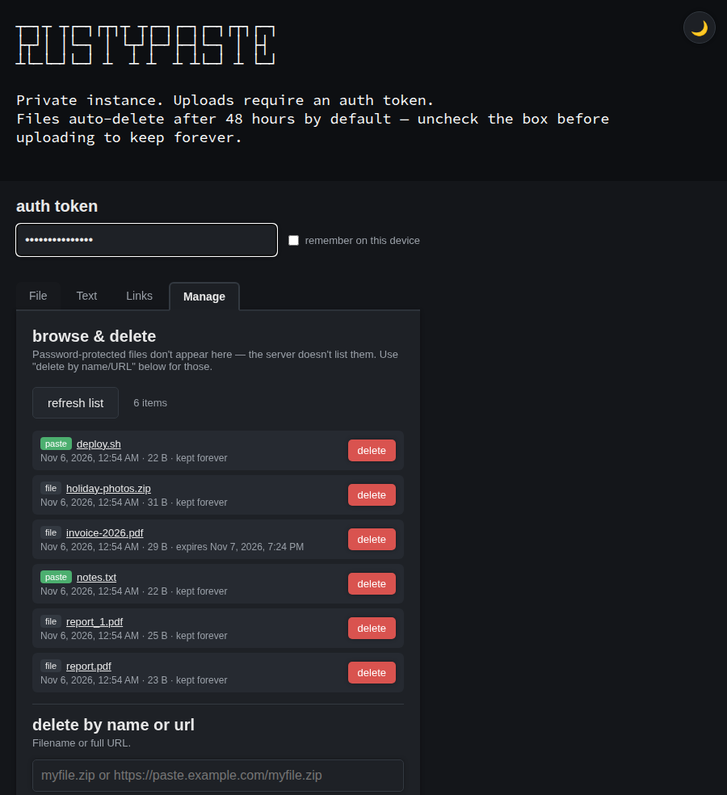

# rustypaste-web

A full-featured, single-file web UI for [rustypaste](https://github.com/orhun/rustypaste). No
build step, no dependencies, no external CSS/JS/CDN — just one `index.html` you drop next to your
rustypaste server.

Dark mode by default, mobile-responsive, and covers every paste type the rustypaste server
supports: normal files, one-shot files/links, password-protected files, URL shortening, and
remote-URL fetching, plus browsing and deleting what you've uploaded.

## Screenshots

| Dark mode (default) | Light mode |
|---|---|
|  |  |

Manage tab — browse & delete, delete by name/URL, and unlock a protected file:



## Features

- **File uploads** — drag-and-drop or click to browse, multiple files in one request, live
  upload-progress bar
- **Upload modes** — normal, one-shot (viewable exactly once), or password-protected
  (auto-generated password shown once, Argon2id-hashed server-side)
- **Text pastes** — paste text directly, no file needed
- **URL tools** — shorten a long URL, make a one-shot redirect link, or have the server fetch and
  re-host a remote file under your own paste server
- **Expiry control** — a checkbox + duration field on every upload type; checked by default at
  `48hour` for files (off for text pastes and links), uncheck it to keep the paste forever (any
  unit rustypaste supports: `ns` `us` `ms` `sec` `min` `hour` `day` `week` `month` `year`)
- **File names** — a "keep original file name" checkbox (on by default) uploads `abc.pdf` as
  `abc.pdf`; if that name is already taken it becomes `abc_1.pdf`, `abc_2.pdf`, … Untick it for
  rustypaste's random names. Works for every file mode and for multi-file uploads (one request per
  file). Names are made safe for the server first (spaces and odd characters become `_`, accents
  are stripped). You can also type a custom name for a single file or paste, which is used exactly
  (a taken custom name is reported, not renumbered). No server changes needed — the UI reads
  `/list` to pick a free name and retries on `409`.
- **Browse & delete** — lists your uploads (needs `expose_list = true` on the server), newest
  first, each with a `file` / `paste` (text) badge, `one-shot` / `url` badges, upload date, size
  and expiry, plus one-click delete. The upload date comes from the `Last-Modified` header of a
  `HEAD` request per plain file (rustypaste's `/list` often returns no creation date); one-shot
  and URL items are never requested, so they show "no date"
- **Unlock tool** — password-protected files return a `404` on a plain browser click (by rustypaste
  design, to avoid leaking which files exist) rather than a login prompt, so this UI includes a
  dedicated "enter URL + password" tool that fetches the file properly
- **Dark mode** — on by default, with a sun/moon toggle (persisted per-browser via `localStorage`)
- **Favicon** — built in (inline SVG), so no extra file or `/favicon.ico` route is needed
- **Mobile-friendly** — fits phone screens properly, no pinch-zooming required
- **Auth token memory** — optional "remember on this device" checkbox, off by default, stored in
  `localStorage`

## Requirements

- A running [rustypaste](https://github.com/orhun/rustypaste) server that you control
- At least one entry in `auth_tokens` (and `delete_tokens`, if you want the delete/browse features)
  in your rustypaste `config.toml`

Some features depend on server config flags. If they're off, that part of the UI will show a clear
error rather than fail silently:

| Feature | Required config |
|---|---|
| Browse & delete (the file list) | `expose_list = true` |
| Delete | at least one token in `delete_tokens` |
| Everything else | at least one token in `auth_tokens` |

**Note:** password-protected files never appear in the browse list — this is a rustypaste
server-side limitation (protected files are intentionally excluded from the `/list` endpoint), not
a bug in this UI. Use the manual "delete by name/URL" tool for those.

## Usage

1. Point rustypaste's `[landing_page]` config at this file:

   ```toml
   [landing_page]
   file = "index.html"
   content_type = "text/html; charset=utf-8"
   ```

2. Make sure `index.html` is readable by whatever user/UID your rustypaste process runs as (the
   official Docker image runs as `1000:1000`).

3. Restart rustypaste so it picks up the new landing page config (some deployments also need a
   restart to pick up the file's *contents* on later edits — if a change doesn't seem to take
   effect after replacing the file, restart the container/process and check again before assuming
   it's broken).

4. Open your rustypaste server's URL in a browser. Enter your auth token at the top of the page —
   it's used for every action, never sent anywhere except your own server, and only stored in your
   browser if you explicitly tick "remember on this device."

## How it talks to the server

Everything here is plain `fetch`/`XMLHttpRequest` against rustypaste's existing HTTP API — no
special backend, no proxy. Uploads are `multipart/form-data` POSTs to `/`, where the form field
*name* selects the paste type (`file`, `oneshot`, `protected`, `url`, `oneshot_url`, `remote`);
expiry and file names are set via the `expire` and `filename` request headers (without a `filename`
header the server picks a random name — this is why a plain upload of `abc.pdf` gets renamed); delete is a
`DELETE /{name}` request with the token in `Authorization`. See rustypaste's own
[README](https://github.com/orhun/rustypaste#usage) for the full API if you want to script against
it directly.

## Security notes

- This UI has no server component of its own and stores nothing except what you opt into
  (`localStorage`, browser-only, never transmitted anywhere but your own rustypaste instance).
- The auth token field is a password input, but it is still visible in your browser's DevTools /
  network tab like any client-side app talking to an API with a bearer token. Treat your rustypaste
  auth token the same way you'd treat any other API key.
- Password-protected file passwords are shown once at upload time and cannot be recovered or
  changed — losing it means losing access to that file.

## License

MIT
